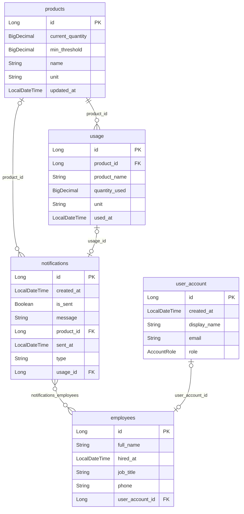

# Schemat bazy danych

Plik generują reguły projektu (panel Maven → Lifecycle → verify). Nie edytujcie go ręcznie.

Tabele: 6 (w tym tabele łączące @ManyToMany: notifications_employees) · kolumny: 31 · relacje: 2 × @ManyToOne, 1 × @OneToMany, 2 × @OneToOne, 1 × @ManyToMany

| Tabela | Encja | Kolumny | Klucze obce |
|---|---|---|---|
| employees | employees | 6 | user_account_id |
| notifications | notifications | 8 | product_id, usage_id |
| products | products | 6 | — |
| usage | usage | 6 | product_id |
| user_account | UserAccount | 5 | — |

